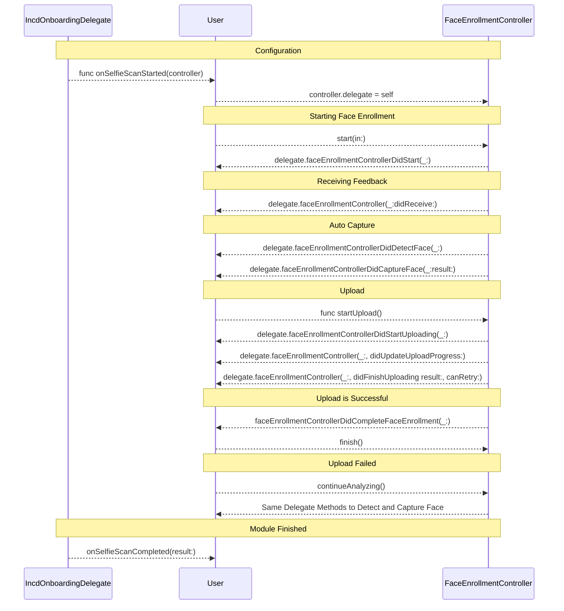
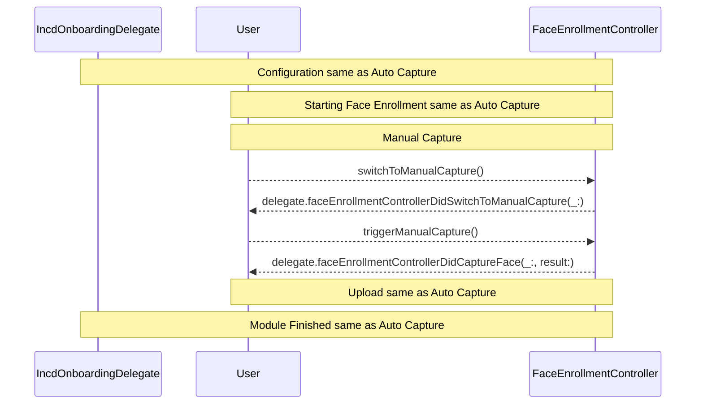

# FaceEnrollmentController Architecture Diagram

Auto Capture Diagram

---
Manual Capture Diagram

## Key Interactions

### 1. User → FaceEnrollmentController (Direct Method Calls)
- `start(in:)` - Begin face enrollment process
- `pauseAnalyzing()` / `continueAnalyzing()` - Control analysis state
- `switchToManualCapture()` - Switch from auto to manual mode
- `triggerManualCapture()` - Manually capture face image
- `upload()` - Upload captured face data
- `stop()` / `finish()` - End the enrollment process

### 2. FaceEnrollmentController → FaceEnrollmentControllerDelegate (Callbacks)
- `faceEnrollmentControllerDidStart(_:)` - Process started
- `faceEnrollmentController(_:didReceive:)` - Real-time feedback
- `faceEnrollmentControllerDidDetectFace(_:)` - Face detected
- `faceEnrollmentControllerDidCaptureFace(_:result:)` - Face captured
- `faceEnrollmentControllerDidSwitchToManualCapture(_:)` - Mode switched
- `faceEnrollmentControllerDidCompleteFaceEnrollment(_:)` - Process completed
- Upload progress and completion callbacks

### 3. Data Flow
- User sets delegate on controller
- User calls controller methods directly
- Controller performs operations and notifies delegate
- Delegate receives real-time updates and final results
